 

---

## About Me

I'm a software developer building intelligent, scalable solutions at the intersection of software engineering and artificial intelligence. My foundation is full-stack engineering across web and mobile applications, backend systems, APIs, databases, cloud and DevOps.

Today I focus on **Generative AI**, **AI Agents**, **Agentic AI**, **RAG**, **MCP** and **AI-powered automation**, and on understanding how these systems work under the hood: LLMs, retrieval pipelines, tools, memory, orchestration and production deployment.

My goal is to grow into an AI-focused software engineer who designs production-ready, intelligent systems that solve real-world problems.

---

## Tech Stack

### Languages

### Frameworks and Libraries

SignalR, ASP.Net Core

### Cloud and DevOps

### Developer Tools

Pandas, NumPy, Scikit-Learn, Matplotlib

### Databases

MS SQL Server

---

---

## GitHub Stats

 

